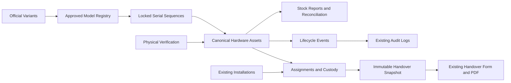

# Hardware Serialization, Inventory and Asset Lifecycle

## Scope and Repository Review

This is an integrated extension of the existing React/Vite CIMS frontend and Express/mysql2 API, using the existing MariaDB database, authentication, individual capability grants, subsidiaries, installations, private file storage and audit service. Discovery found installation quantity fields and handover equipment configuration, but no serialized asset registry. No historical equipment was inferred from installation quantities and no duplicate installation module was created.

The source naming reference is `Marezi_Kiosks_Serial&Model_Number_Naming_Convention (2).pdf`. Core / MC / M is the user-selected CIMS extension, not a product defined by that PDF.

Primary implementation:

- `server/services/hardwarePolicy.js`: formats, eligibility, subsidiary scope and lifecycle rules.
- `server/services/hardwareInventory.js`: transactions, issuance, registry, governance, movements, replacements, reconciliation and snapshots.
- `server/routes/hardware.js`: authenticated API, identifier validation and safe errors.
- `server/security/inventoryBoundary.js`: additional boundary for the new Inventory Officer role.
- `src/components/inventory`: native inventory workspace, technician installation controls and QR scanning.
- `server/migrations/20261012_hardware_inventory.sql`: additive schema.

Existing installation details and entry workflows include serialized hardware. Newly saved installations open their existing details dialog for equipment selection when the user has inventory access. Existing handover previews and PDFs include the hardware table, using a frozen snapshot when present. Existing signed documents are not regenerated or rewritten.

## Architecture



One asset row represents one registered device or reserved serial. Historical assignments and movements never create extra physical devices. Ownership, location, custodian, installation reference, condition, verification and registration approval are separate fields.

All new tables use InnoDB and `utf8mb4_unicode_ci`, matching their foreign-key parents. The local database defaults to a different collation, so explicit table collation is necessary.

## Naming and Approval

Model: `[NICKNAME]-[YY]-[VARIANT][MODEL SEQUENCE]`.

Serial: `MRZ-[FAMILY]-[VARIANT][MODEL SEQUENCE]-[YY]-[UNIT SEQUENCE]`.

Examples: `Wave-26-C1`, `Core-26-M1`, `MRZ-MC-M1-26-1001`.

The PDF defines serial YY as the model introduction year. The backend therefore requires the selected serial year to match the model year. Manufacturing year is recorded separately and may be unknown for legacy hardware. Edge historical backfill uses its actual manufacturing year in the model and serial.

The configured partition is per model and serial year, globally shared across subsidiaries. New model-year series start at 1001. The four-digit unit sequence stops at 9999; years are bounded to 2000-2099 to avoid two-digit century collisions. Different same-year models receive distinct model sequences. Model identifiers and issued serials are immutable.

Issuance is disabled until an authorized administrator approves the partition and records an organizational approval reference in the Policy tab. Field approval is required by default. Policy changes and model decisions produce audit records.

Seeded variants: Wave/QMS/C, Edge/QMS/E (historical only), Anchor/QMS/W, Vault/SSK/R, Lite/SSK/S, Tap/DS/T, Glow/DS/N, Pulse/FBT/K, Beacon/LED/D and Core/MC/M. Models are proposed and approved through governance; example years are not silently treated as approved manufacturing designs.

Cosmetic and software amendments retain the model identifier and record specification revisions. Hardware redesigns require a new model proposal. A rejected model cannot be converted into an approved historical model by retiring it.

## Inventory Officer and Security

The stored role code is `InventoryOfficer`; the interface displays Inventory Officer. User creation and role updates require an owning subsidiary for this role. Its default workspace is Hardware & Inventory.

The role includes scoped issuance, registration, receipt, allocation, reservations, service operations, reconciliation, field approvals, reports, exports, QR printing, archival and draft deletion. Model approval, policy approval, cross-subsidiary access, retirement/disposal approval, verified identity correction and bulk import approval require separate grants. SuperAdmin retains overall authority.

Inventory Officer does not inherit access to unrelated legacy business endpoints. The new role boundary preserves existing behavior for all prior roles. Its notification bell keeps personal notifications and announcements without fetching unauthorized business lists. Company settings expose branding fields to an officer without company-management permission.

Every inventory endpoint is behind the existing session authenticator. QR links do not bypass authentication or ownership checks. Identifiers and filters are validated; SQL values are parameterized. A forged destination location or installation cannot bypass subsidiary checks. Frontend query caches include user, subsidiary, role and grants to avoid carrying cached inventory across scope changes.

QR codes contain only an origin URL and opaque asset ID. Technical assignment configuration is excluded from ordinary registry, export and handover payloads. It is exposed on the authorized asset profile only with inventory-edit permission; model specifications require model-governance access. Supporting files reuse private file storage and have an additional hardware permission/scope boundary.

For production, maintain TLS, encrypted database/storage/backup volumes, private runtime secrets and protected backup access. Existing startup schema initialization remains part of CIMS; replacing all startup DDL with deployment-only migrations is a separate hardening task.

## Operator Guide

1. Sign in to the local CIMS application and open Hardware & Inventory.
2. Propose the appropriate model in Models, then have a model administrator approve it. Core-26-M1 uses Core / MC / M and year 2026.
3. Have a policy administrator approve the serialization policy with its organizational reference.
4. Add subsidiary-owned inventory locations.
5. Generate one or more serials. These enter Generated with no physical verification and no assumed physical condition.
6. On the asset profile, use Receive & Verify after checking the actual device, manufacturer identity, condition and stock location. Only approved, verified, reconciled assets in acceptable condition enter available stock.
7. Reserve for an installation or assign to an authorized technician/installation. Release unused reservations when appropriate.
8. In existing installation details, search or scan an eligible serial and add it, or use Register & Generate when field-registration permission is granted.
9. Approve pending field registrations before confirming Installed. Completion and handover upload reject linked hardware that remains unverified, unapproved or not installed.
10. Use the asset profile for faults, servicing, returns, transfers, replacement, approved retirement, disposal and archival.

Technician grants are explicit: typically `inventory.view`, `inventory.assign`, `inventory.install`, `inventory.field_register` and optionally `inventory.print_qr`. Existing installation permission and assignment checks still apply. Technicians cannot choose arbitrary model codes or generate offline serials.

Receive/verify accepts only Generated or Returned assets without an active allocation. Generated slots, pending approvals, unacceptable conditions, missing stocktake observations, retired devices and disposed devices cannot be allocated.

Stocktakes accept scanned opaque IDs or manually entered existing serials. Duplicate references to the same physical asset are rejected. Missing observations remove the asset from availability without inventing a physical stock movement. Unexpected identifiers are returned as discrepancies without exposing another subsidiary's records.

Legacy backfill preserves existing serials and actual years. Unknown serials or years remain marked for reconciliation; the system does not fabricate historical numbers or dates. Unknown legacy serials may receive an opaque QR label identifying the asset, explicitly showing the serial as unknown. Unissued drafts cannot receive official labels. Identity reconciliation requires the separate identity-correction permission.

## Lifecycle and Integrity

### Quantity-driven Selection and Handover Images (14 October 2026)

Model specifications now reserve `installation_equipment_field` for a supported installation quantity key. Inventory register permission controls Map Equipment Item and mapping during serial generation; linked devices prevent remapping to a different equipment field. The catalogue exposes only this mapping to ordinary inventory readers, preserving specification confidentiality. Subsidiary handover equipment labels are reused in the installation serial picker. Equipment categories are activated by catalogue model mappings, including explicitly mapped accessories; no new database columns or migration are required. Existing families provide their conventional mapping until explicitly configured.

Installation POST/PATCH accepts optional `hardware_selection: { assets: [{ asset_id, equipment_field }], physical_confirmed, mark_installed }`. The API bounds selections to 100 unique registered devices, validates the model mapping against each quantity, locks assets in deterministic ID order, checks subsidiary and technician installation scope, and allocates/installs within the installation transaction. Complete saves additionally require exact serialized quantities where approved mapped models exist. Requests without selections retain the existing planning workflow. Completed/signed installations retain the return/replacement workflow and frozen snapshots. Repeated selection of already-linked installed assets does not create duplicate active assignments. Failures roll back installation values, inventory states, assignments and audit records together.

Both handover upload paths use `handoverSupportingDocuments.js`. PDF.js runs in a separate child process with script evaluation disabled and local font/CMap assets; native decoder failures cannot stop the API. Inputs are capped at 10 MB, 20 pages and 30 seconds; rendering concurrency is two. PNG dimensions are bounded to 1800 x 2400, decoded image pixels to 16 million, and output to 50 MB before per-device copies. Each Installed asset receives its own private file records and paths; a 100 MB aggregate cap prevents unbounded duplication. Private files and audit entries are created within the handover transaction and paths are removed on rollback. Original handover files and frozen hardware snapshots are retained. No historical uploads are automatically backfilled.

The Files router imports its existing secure token helpers and permits inventory-specific image viewing only within the same owning subsidiary (or SuperAdmin). Its SQL scope checks remain in effect; ordinary document access is unchanged. The missing token imports previously prevented nonempty supporting-document lists from being serialized.

Runtime: Node.js 20.19+ (22.13+ or 24 supported), pinned PDF.js 5.5.207 and native canvas. This PDF.js pin avoids the audited vulnerable 5.6.x range while retaining the project's Node 20 runtime family. Follow the deployment's regular dependency review before changing the pin. Validation includes PDF/image pixel checks, rollback cleanup, intercepted desktop/mobile browser workflows and isolated MariaDB allocation/completion/file-scope integration. The repository-wide type check still reports the four previously documented Chat/Finance errors. Rollback restores the scoped service/frontend changes and dependencies and rebuilds/restarts the app; retain model mapping metadata, inventory records, serial counters, original handovers and supporting files.

### Technician Allocation Feedback (14 October 2026)

The registry Assign/Reserve form now exposes physical identity confirmation for User-role technicians, matching the existing backend allocation requirement. Previously those forms always submitted `physical_confirmed: false`, and failures appeared only in a toast outside the active dialog. Missing confirmation is now rejected locally with a persistent inline error; API failures also remain in the operation dialog while preserving selections for retry. Opening a new operation or retrying clears the previous error. Backend permissions, subsidiary checks, stock eligibility, idempotency and audit behavior are unchanged; no database migration is required.

The intercepted browser regression fixture covers missing confirmation without a POST, server rejection with a visible inline message, and confirmed successful retry at desktop and mobile widths. Rollback consists of restoring this scoped form change and rebuilding the frontend; preserve all inventory records and serial counters.

Operational statuses are Generated, Available, Reserved, Assigned, Installed, Faulty, Under Maintenance, In Transit, Returned, Retired and Disposed.

The backend enforces transitions. Retired and disposed equipment cannot return to available stock. Returns and completed repairs require physical re-verification. Reservations record expiry and reject allocation after expiration; unused/expired reservations are released by an officer rather than silently counted as available.

Serial and model counters use exclusive upserts and row locks. Concurrent requests are retried a bounded number of times after database deadlock or lock-timeout rollback. Issuance, receipt, allocation, replacement, returns, transfers, approvals and reconciliation write their history and audit data in the same transaction.

An indexed generated column enforces one active assignment per physical asset. Replacement locks both assets in deterministic order, closes the old assignment and installs the eligible replacement atomically. Neither serial is overwritten. Cross-subsidiary transfer requires its separate permission, a destination location and approval reference; dispatch and receipt are separate events.

Every mutation requires `Idempotency-Key`. Repeating the same key and payload returns the recorded response; changing the payload with a used key returns 409. The frontend retains a pending key for in-session network retries and deduplicates simultaneous identical submissions. Integrations should retain their keys through reconnects/restarts.

Deletion is a tombstone for eligible unissued drafts only. Issued records, events and snapshots are retained. Foreign keys prevent deleting referenced assets, users or installations. Existing client/user deletion reports a conflict when retained history prevents deletion; an affected user should be deactivated instead.

## Handover Preservation

Installation completion and both existing handover upload paths share the hardware completion guard and transaction. A first completed hardware handover captures serial, model, manufacturer identity, condition, installation location/date and technician reference.

The snapshot is never overwritten after return, transfer, replacement or model amendment. A pre-existing signed handover without a hardware snapshot remains historical; subsequent backfill is not retroactively inserted into that signed document. Current equipment remains visible in installation details separately.

Replacement history records old and new serials. Approved signed handover amendments continue through the existing document/version workflow; automatic amendment-document generation and version-specific hardware snapshot selection are not implemented.

## Reports, Imports and Labels

Registry and asset reports support scoped server-side pagination, search, sorting, subsidiary/family/model/location/client/branch/technician/date filters, CSV, XLSX and PDF export. History reports cover movements, replacements and selected-asset lifecycle with pagination and history-date filters.

Available is computed from verified physical assets that are approved, in New/Good/Fair condition, reconciled, unarchived and free of an active assignment. It excludes generated serials. Status summaries aggregate the current asset rows, never historical assignments. Pending approval and reconciliation metrics are subsets/attributes, not extra physical units. An Available-state row with a stock discrepancy is excluded from the availability metric.

Stock Alerts includes configurable minimum stock per model/location, warranty horizons, aging thresholds and stock discrepancies. These are on-screen alerts; scheduled email/SMS/push delivery is not implemented.

CSV/XLSX imports accept reviewed Legacy or Draft records, not arbitrary newly generated official serials. Preview validates models, scope and duplicates; commit requires import, registration and separate approval permission plus an approval reference. Up to 500 rows are reviewed per batch. Row savepoints report any race-time failure, while successful rows and the complete batch result commit idempotently. Retry only the rejected rows with a new batch key after reviewing the results.

Import columns: `source,model_id,subsidiary_id,location_id,manufacturing_year,serial_number,manufacturer_serial,installation_id,physical_confirmed,condition_grade`. The final three fields are needed for installed legacy backfill; unknown serial/year values remain blank. Identifiers are available from registry/catalog API responses.

The browser limits files to 5 MB. Spreadsheet exports neutralize formula-leading text. Private technical configuration is not included in exports.

Labels have single/bulk previews, A4 eight-label sheets, 100 x 60 mm thermal PDF layouts and permanent opaque QR links. Printing/export is audited. QR scanning uses the camera when available; manual serial/ID entry is supported. Camera use needs a secure browser context such as HTTPS or localhost.

## API Reference

All paths below are under `/api/hardware` and require a valid existing CIMS session.

| Method | Path | Purpose |
|---|---|---|
| GET | `/catalog` | Authorized variants, models, subsidiaries, locations and pickers |
| GET | `/assets` | Scoped paginated current registry |
| GET | `/assets/:id` | Authorized profile and history |
| GET | `/summary` | Current-state counts and eligible availability |
| GET | `/alerts` | Low stock, warranty, aging and discrepancy alerts |
| GET | `/models/:id` | Model specifications and governance history |
| GET | `/installations/:id` | Current hardware and immutable handover rows |
| GET | `/movements` | Paginated history and replacements |
| GET | `/reports`, `/export` | Permission-controlled asset reports/exports |
| POST | `/generate` | Single/bulk issuance or authorized field registration |
| POST | `/register` | Draft or historical registration |
| POST | `/import` | Reviewed import preview/commit |
| POST | `/reconcile` | Physical stocktake |
| POST | `/policy` | Formal serialization and field-approval policy |
| POST | `/model_propose`, `/model_approve`, `/model_edit` | Model governance |
| POST | `/location`, `/alert_rule` | Scoped locations and alert configuration |
| POST | `/assets/:id/:action` | Permission-controlled lifecycle command |

Actions: verify, approve, assign, reserve, release, install, return, fault, maintenance, repair, transfer, receive_transfer, replace, retire, dispose, archive, edit, identity, delete_draft and print.

Example issuance body (approved identifiers and policy are required):

```json
{
  "model_id": "<approved-model-id>",
  "subsidiary_id": "<owning-subsidiary-id>",
  "serial_year": 2026,
  "manufacturing_year": 2026,
  "quantity": 5
}
```

Send an `Idempotency-Key` header. Typical errors: 400 invalid data, 401 missing/expired session, 403 permission/scope denial, 404 unavailable scoped record, 409 identity/state/idempotency conflict, 503 disabled rollout/missing schema. Internal database messages are not returned by the hardware API.

## Local Rollout and Production Deployment

The confirmed local development database was backed up and migrated. The API is running on 8081 behind Vite at `http://localhost:8090`. `HARDWARE_INVENTORY_ENABLED=true` is set in the ignored local environment file. Production has not been deployed or migrated.

Backup: `server/backups/backup_riana_cims_2026-10-12_20-45-18-591.sql`; SHA-256 `030c62a4c40a7c4b560667e2de7daec38295c0b27d649c3ef5da387354415fa8`. Before/after row counts were unchanged for clients (2), installations (3), assignments (4), handovers (4) and users (3). No real serial was issued or policy approved by this implementation session.

Repeatable local-only command:

```powershell
node server/scripts/apply-hardware-migration.cjs --apply-local
```

It requires a local non-production database, creates a consistent backup, checks existing roles, takes a migration lock and records migration history. It applies only this migration, not unrelated older migrations. MySQL DDL is not transactional; partial additive failures can be reviewed and retried safely before enabling the feature.

Production rollout requires the approval and validation specified in the user's master prompt:

1. Review code, migration, pending decisions and security baseline; validate in staging.
2. Back up and verify the database, private documents and runtime secrets/keys. Keep backups encrypted and access restricted.
3. Keep `HARDWARE_INVENTORY_ENABLED=false`; apply the reviewed SQL with approved migration credentials.
4. Deploy the API/frontend together and restart the API. Existing startup registers the Inventory Officer role and capability definitions.
5. Enable the feature, verify authentication/scope/health and create real subsidiary-bound officer accounts through existing user management.
6. Approve actual model definitions and the formal serialization policy, then perform supervised first issuance/receipt/assignment/handover checks.
7. Confirm the hosting process timezone matches the organization's calendar before year-boundary issuance.

Do not overwrite existing signed documents or import fictitious legacy units. Do not change the original root accounts or provider credentials.

## Rollback and Recovery

Set `HARDWARE_INVENTORY_ENABLED=false` and restart the current API. The non-destructive rollback SQL disables issuance. Retain hardware tables, counters, role enum support, events and snapshots.

Never restore a pre-issuance database over an active serial ledger after issuance; doing so could reuse official numbers and erase traceability. Restore backups into an isolated recovery database first, reconcile all post-backup issued serials and movements, and perform an approved forward recovery. Do not deploy older startup code that narrows the role enum while Inventory Officer accounts exist.

## Verification and Remaining Limits

Backend regression tests cover authentication/session security, existing roles, notifications, files, handover equipment fields, naming, eligibility, scope and idempotent transactional issuance. An isolated local MariaDB integration suite validates the actual migration, concurrent sequence issuance, duplicate concurrent retries, conflicting assignments, field approval/completion guards, imports, model governance, reconciliation, transfers, replacements, service operations, disposal and immutable snapshots. It never connects to a remote host and retains uniquely named `cims_hardware_test_*` databases for inspection.

The Playwright fixture harness validates generation, profiles, label rendering and viewport framing across desktop/tablet/mobile and light/dark themes. It intercepts every API request and does not use a real account or issue real serials. Screenshots and results are under `tmp/hardware-qa`. Browser-plugin invocation failed with `CryptUnprotectData failed: 2148073483`; the requested UI QA used local Playwright as the fallback.

Final local verification (2026-10-13): backend suite 66 passed, zero failed, one opt-in database test skipped; that database suite passed separately against a fresh isolated MariaDB database. All seven Playwright viewport/theme cases passed without JavaScript errors or horizontal overflow. Production build and bundle verification passed. Full TypeScript checking still reports four existing Chat/Finance errors. Model specification amendments now merge changed fields, preserving unrelated specifications; the database suite covers that behavior.

```powershell
npm.cmd --prefix server test
node scripts/hardware-ui-qa.cjs
npm.cmd run build
```

For the actual database suite, explicitly set a fresh `HARDWARE_TEST_DATABASE=cims_hardware_test_<unique_suffix>` and local `HARDWARE_TEST_HOST`, `HARDWARE_TEST_USER`, `HARDWARE_TEST_PASSWORD`, `HARDWARE_TEST_PORT`, then run `node --test server/services/hardwareMySql.test.js`. No application `.env.local` is loaded by that test.

Outstanding verification: physical camera scanning, real thermal/A4 printer alignment, hosted production rollout and supervised real stock data. UI fixtures are not a substitute for these device/production checks.

The full application TypeScript check has existing errors in ChatModule and FinancesModule; the new inventory code does not produce TypeScript diagnostics. The repository dependency audit has existing advisories outside this feature that must be assessed before production sign-off. Production acceptance is therefore pending that baseline review and the rollout/device checks above.

Scheduled notification-channel alerts and automatic signed handover amendment generation remain partial/pending; their in-app alert/history and immutable-original preservation foundations are implemented. Official offline serial generation is deliberately unavailable.

Maintenance currently removes equipment from its active assignment. Replace installed/faulty hardware before sending the removed device to maintenance; replacing a device already removed for maintenance is not yet a supported combined workflow. Large exports use paginated queries, not a single database snapshot: avoid concurrent inventory updates when preparing reconciled exports, pending a consistent-snapshot export implementation.

## Simplified Operating Workflow (2026-10-13)

1. Propose and approve the official hardware model; approve the serialization policy separately with a real organizational approval reference.
2. Generate a single serial or batch. Serial year is derived from the approved model, not editable in the generation form. The resulting generated records are selected for label printing; they are not physical available stock.
3. Receive and verify each physical device, manufacturer identity, condition and location.
4. Allocate by Client, then Client / Branch Installation, and Receiving Technician. Client selection narrows installation choices; backend checks reject mismatched clients. Alternatively allocate custody to a technician without an installation.
5. The assigned technician can select their allocated equipment at their authorized installation. This links the existing active custody assignment rather than duplicating it. Eligible reservations for that installation also appear. Completed installations reject normal allocation, including reserved-device conversion.
6. Confirm physical installation and any required field approval before completion/handover. Existing completed handover snapshots remain unchanged.
7. Use filtered reports for available physical stock, generated/unverified serials, client installations, technician allocations and lifecycle events. Available filters use actual eligibility, not status alone. Registry/export branch names consistently fall back to the client's historical branch when no branch record is linked.

Model history now displays named specifications, decisions, reasons and revision dates without raw JSON. Dashboard navigation clears stale report restrictions; status changes update the availability filter. Backend counters, unique identities, subsidiary permissions, immutable serials, idempotency keys and audit trails remain unchanged. This update is code-only; no application asset, client or installation records were changed. Roll back the scoped code and restart the API if required; do not reset sequences or remove history.

Verification for this update includes isolated MariaDB client/custody/assignment controls, available/report read paths, and Playwright generation, allocation and readable-model-history checks across seven viewport/theme cases. Existing limitations on concurrent paginated exports, scheduled alert channels and signed amendments still apply.

## Troubleshooting Details

### Guided Tour and Operator Documentation

The module header's Module Tour opens a repeatable role-aware spotlight walkthrough. Driver.js highlights real feature anchors and scrolls them into view with an adjacent explanation. It previews Registry, Models, Locations, Policy, Reports and Stock Alerts as permitted, without mutations, and restores the user's previous tab when closed or finished. Steps unavailable to the user's permission set are omitted. React tab renders finish before highlighting so control class updates cannot remove the spotlight. Missing asset-dependent controls fall back to registry entry points rather than fabricating demonstration records.

The global profile/avatar menu includes System Tour. It highlights the actual authorized sidebar entries and shared header controls, without changing the active module or following external links. On mobile the main shell temporarily previews a nonmodal navigation drawer and restores its original open state afterward; tour-only outside-interaction guards keep the drawer stable while the spotlight moves. Ordinary navigation remains modal and unchanged outside the tour.

See [Hardware & Inventory User Guide](HARDWARE_INVENTORY_USER_GUIDE.md) for operator workflows and tour entry points. Shared positioning, keyboard controls and safe static descriptions are in components/tours/guidedTour.ts with scoped theme styling; systemTour.ts uses existing authorized navigation markers. HardwareTour.tsx supplies permission-aware inventory steps. Driver.js 1.9.0 is lazy-loaded only when a tour starts; its [official configuration documentation](https://driverjs.com/docs/configuration) describes the spotlight and navigation hooks. No schema, authentication or business permission changes are introduced. Rollback removes the scoped tour integrations/markers from Header, Sidebar, Index and HardwareInventoryModule, restores HardwareTour's previous implementation and removes the shared tour files/dependency if unused; retain all records and counters.

Tour verification: seven desktop/tablet/mobile light/dark cases passed full navigation, Back, Finish, Escape, viewport framing and previous-tab restoration without any mutation requests. Additional Management and InventoryOfficer cases confirmed permission-specific step filtering. Existing inventory UI regression checks and production bundle verification passed. The full TypeScript check still reports only the four existing Chat/Finance diagnostics, not new tour errors. Physical device testing remains separate from this fixture-based browser validation.

Spotlight refinement verification also checks actual highlighted DOM targets. Global tour fixtures cover SuperAdmin and InventoryOfficer on desktop and mobile, including unavailable-navigation exclusion, the Inventory navigation anchor and restoration of the preview drawer, without mutation requests. The signed-in production shell, external sites and module-specific detailed walkthroughs outside Hardware & Inventory are not claimed as fully tested: the System Tour is a global navigation overview, while the inventory Module Tour is feature-level guidance. Existing dependency audit advisories remain unchanged at 27 (8 moderate, 19 high); no unrelated dependency fixes were applied.

Final spotlight checks passed after resolving two transition edge cases: React renders finish before attaching the active highlight, and unavailable targets fall back to a safe visible header rather than highlighting the document body (which would disable popover controls). The final production build/bundle verification passed, with zero browser runtime errors in the fixture suite. Main-shell/global markers are additive; backend routes, permissions and records were not changed for these tours.

### Inventory UI Refinement and QR History

The 2026-10-13 refinement separates missing serial identity, physical verification, registration approval, reconciliation and condition. Legacy installed hardware without an identity displays Serial Pending Reconciliation; unissued drafts display Not Issued; missing condition displays Not Assessed. No historical values are filled in or automatically issued.

Primary filters are search, subsidiary and status; advanced filters preserve family/model/location/client/branch/technician/date/sort/archive selections when collapsed. Client changes clear dependent branches, subsidiary changes clear dependent location/client/technician filters, and family changes clear the model. Search requests are debounced by 300 ms. Export formats share an accessible dropdown; existing import, stocktake, draft and label operations remain available. Selection counts and deselection, server-side page sizes (15/30/50/100), scoped row detail/history menus, compact primary metrics and expandable secondary metrics are implemented. Mobile uses readable record rows; desktop retains the complete table with controlled internal scrolling on tablet.

QR links and decoded in-app asset identifiers open the authorized asset profile with its lifecycle timeline first. Manual serial scan results resolve an exact matching asset; unmatched or denied results do not bypass access controls. History, model specifications, technical configuration and movement/export details use human-readable fields instead of rendered JSON. Operator IDs remain authoritative; read-only joins provide current display names, with recorded IDs or Not Recorded as fallback. Audit timestamps display Africa/Nairobi (EAT). SuperAdmin retains all defined capabilities and global inventory scope; business-state, authentication and integrity controls are intentionally not bypassed.

Changes are scoped to HardwareInventoryModule.tsx, hardwareApi.ts, hardwareInventory.js audit reads, hardwareMySql.test.js and hardware-ui-qa.cjs, building on the preceding QR changes. Existing Button, Input, Checkbox, Tabs, Table, Dialog and DropdownMenu components are reused. No database migration or production deployment is needed for this refinement. Rollback restores only these scoped code changes and restarts the local API; retain all data and serial counters.

Executed checks: 66 backend tests passed, zero failed (the opt-in database test skipped in that run and passed separately); isolated MariaDB controls/operator joins passed; seven desktop/tablet/mobile light/dark UI cases passed generation, allocation, filter persistence, serial clarity, reports, operator CSV exports and QR-linked history without JavaScript errors or page overflow; production build passed. Four preexisting Chat/Finance TypeScript errors remain. Browser invocation previously failed with CryptUnprotectData; local Playwright was used. Camera/printer hardware testing, full hosted regression, newly refined Excel/PDF export visual inspection and all import/stocktake edge-case UI interactions still require supervised acceptance. Unsupported multi-asset assignment/transfer/archive operations were not invented; current bulk selection continues to support label printing. Paginated exports retain the previously documented concurrent-update limitation.

- Inventory page reports an operation failure: the 2026-10-13 compatibility fix uses `clients.branch` as the fallback because installations only have `branch_id`, and explicitly reconciles the existing branch table's general collation with unicode identifiers. No schema conversion or existing data change is required. The database fixture now reproduces those schema differences; actual local catalog, summary, list, alerts, movements and all installation hardware reads were verified.
- Proxy `ECONNREFUSED`: verify the API is running on 8081 and use `npm.cmd run start:all` for the standard development stack.
- Inventory 503: check the feature flag, migration history and API restart; do not bypass the rollout gate.
- Issuance 409 for policy: obtain actual organizational policy approval and approve a current model.
- Available count lower than registry status rows: inspect verification, registration approval, condition, reconciliation, archive and active assignment.
- Field installation blocked: approve pending registration and confirm the physical serial as Installed before completing/uploading the handover.
- Duplicate identity: find the existing asset by manufacturer/Marezi serial instead of generating another physical record.
- Unknown legacy year/serial: preserve unknown values and request authorized identity reconciliation; never fabricate a historical number.
- Browser camera unavailable: use manual serial/opaque ID search and check HTTPS/device permission.
- History prevents deletion: retain the record; deactivate personnel or archive eligible hardware.
- Deadlock/conflict: the backend performs bounded retries; refresh state and retry with the same idempotency key for an uncertain result.
